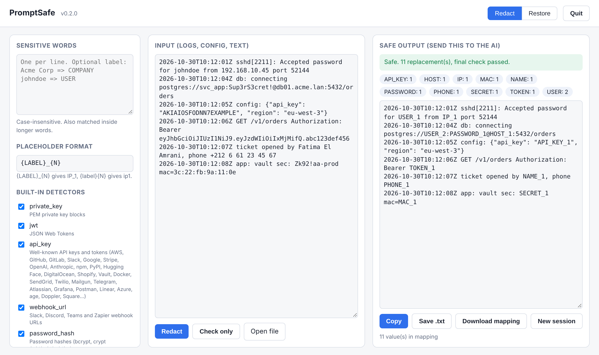

# PromptSafe

PromptSafe hides passwords, keys, IPs, names and other sensitive data in your
logs and text **before you paste them into an AI**. Each value becomes a
placeholder like `IP_1` or `PASSWORD_1`, and you can put the real values back
into the AI's answer afterwards. Runs 100% offline on Linux and Windows.

```
before: Accepted password for johndoe from 192.168.10.45 port 52144
after:  Accepted password for USER_1 from IP_1 port 52144
```

## Install

**Linux**

```sh
curl -fsSL https://github.com/ayourr/PromptSafe/releases/latest/download/install.sh | sh
```

**Windows** (PowerShell)

```powershell
irm https://github.com/ayourr/PromptSafe/releases/latest/download/install.ps1 | iex
```

Or download the file for your system from the
[Releases page](https://github.com/ayourr/PromptSafe/releases/latest).

## Use

### In your browser (easiest)

```sh
promptsafe gui
```

Your browser opens **http://127.0.0.1:19951**. Paste your logs or text on the
left, click **Redact**, and copy the safe output on the right. The page only
runs on your own computer; nothing is sent anywhere.



### In the terminal

```sh
promptsafe redact app.log > safe.txt          # clean a file
promptsafe redact -w words.txt app.log        # also hide your own words (one per line)
promptsafe redact -m map.json app.log > safe.txt
promptsafe restore -m map.json answer.txt     # put the real values back into the AI's answer
```

If anything sensitive is still left, PromptSafe blocks the output instead of
printing it.

## More

All commands, options, detectors, the config file and known limits are in
[docs/reference.md](docs/reference.md).

## License

Apache License 2.0. See [LICENSE](LICENSE) and [NOTICE](NOTICE).
